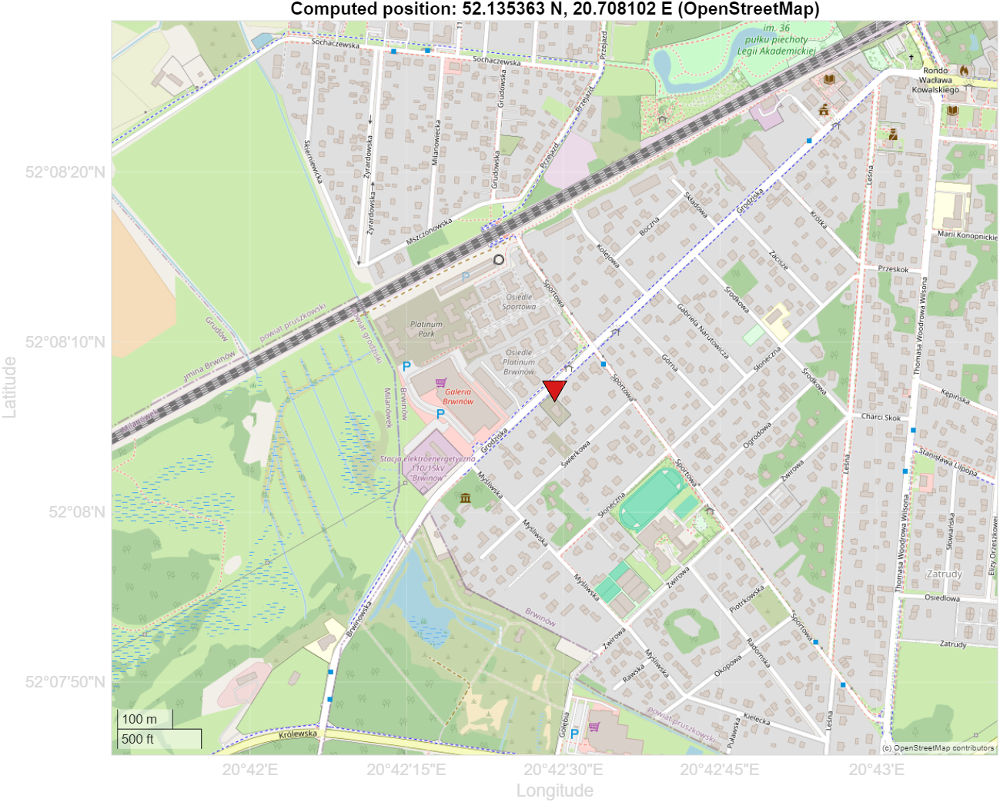
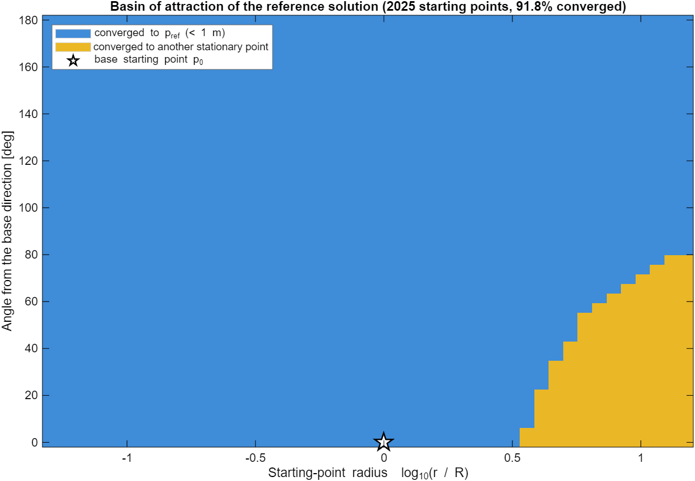
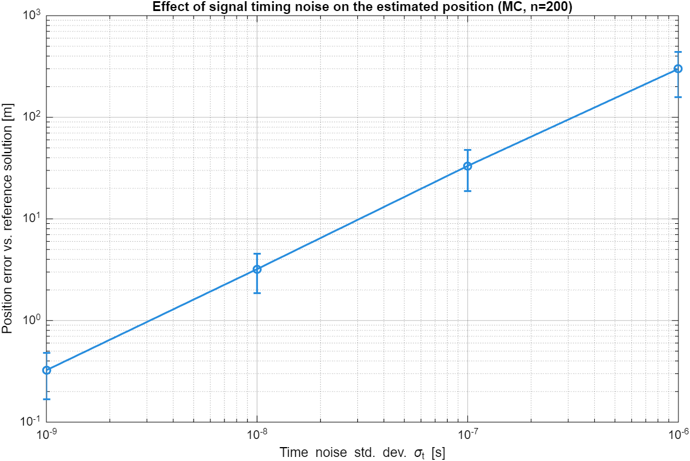
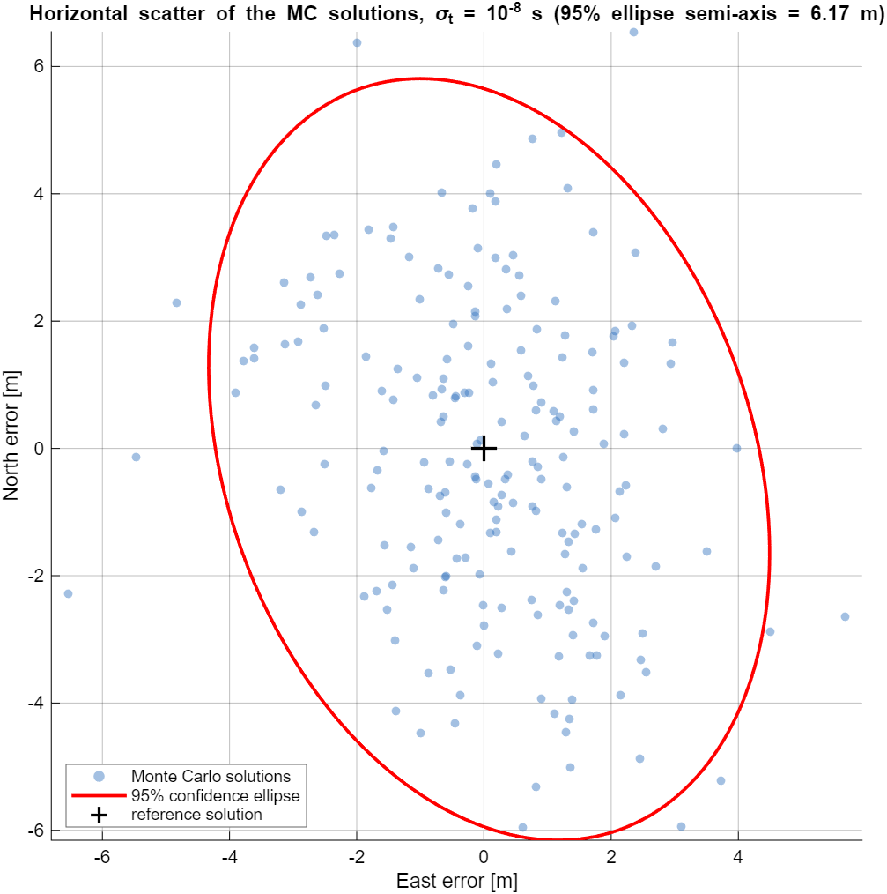
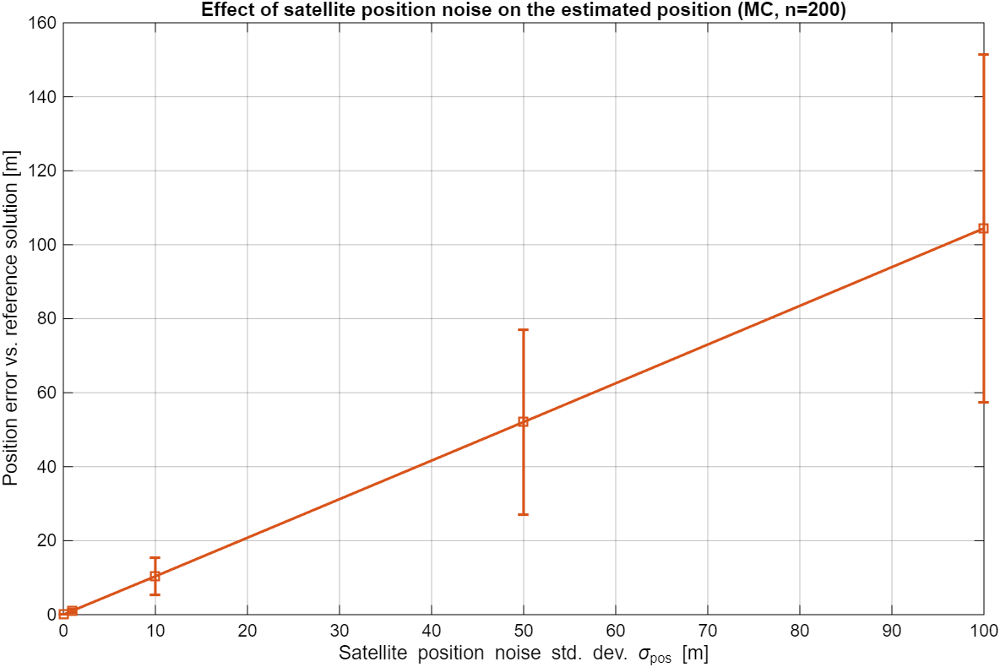

# Satellite Positioning with the Levenberg–Marquardt Method

MATLAB implementation of GPS satellite positioning using the
Levenberg-Marquardt nonlinear least-squares method (`lsqnonlin`), with
sensitivity and perturbation analysis.

Given the positions of `N` GPS satellites and the time each satellite's
signal took to arrive, the receiver's position is recovered by solving an
overdetermined system of range equations as an unconstrained least-squares
problem. The result is then verified against a real map.

It started as a numerical-optimization course project, which is why the
column names in the input CSV are in Polish — everything else is in
English.

## Method

Given `N` satellites with known geographic position (latitude, longitude,
altitude) and the signal travel time `t_i`, find the receiver position
`p = (x, y, z)`.

1. Convert satellite coordinates from spherical (lat/lon/altitude) to
   Cartesian (ECEF).
2. Each satellite gives one range equation `||p - Sat_i|| = c * t_i`. With
   `N > 3` satellites the system is overdetermined, so it is solved as a
   least-squares problem:

   ```
   min_p  sum_i ( ||p - Sat_i|| - c*t_i )^2
   ```

3. Solve with Levenberg-Marquardt — `lsqnonlin` with the analytic Jacobian
   supplied. The same problem is also solved by `matlab/lm_solve.m`, a
   from-scratch damped Gauss-Newton implementation, as an independent
   cross-check: the two agree to 3e-8 m.
4. Analyse sensitivity to the starting point, to the solver's stopping
   tolerance, and to noise injected into the input data (signal timing and
   satellite position errors), via repeated solves and Monte Carlo runs.
5. Verify the computed coordinates against a real map (OpenStreetMap tiles,
   plotted from MATLAB).

## Repository layout

```
data/           input CSV (satellite positions + signal arrival times)
matlab/         MATLAB source
  main_gps.m      entry point: loads data, solves, runs sensitivity analysis
  gps_residuals.m / gps_jacobian.m   residual + Jacobian of the LSQ problem
  gps_model.m     [F, J] interface expected by lsqnonlin
  lsq_history.m   OutputFcn recording the lsqnonlin iteration history
  lm_solve.m      own Levenberg-Marquardt solver (cross-check)
  sph2ecef.m / ecef2sph.m            spherical <-> Cartesian conversion
  ecef2enu.m      rotation into the local East-North-Up frame
  dop_metrics.m   elevation, azimuth and dilution-of-precision factors
results/        figures, solver log and .mat file generated by main_gps.m
```

## Running it

Requires MATLAB with the Optimization Toolbox. The Mapping Toolbox and an
internet connection are optional and only used for the two map figures —
the script warns and skips them if either is missing.

```matlab
run('matlab/main_gps.m')
```

This reads `data/dane_45.csv`, solves for the receiver position, runs the
sensitivity analysis, and writes figures and a log to `results/`. The whole
run takes about a minute, most of it spent on the ~4000 Monte Carlo and
basin-of-attraction solves.

## Results

On the sample dataset (8 satellites):

```
--- Reference solution (lsqnonlin, tol = 1e-12, base x0) ---
x = 3662035.037822
y = 1384359.511942
z = 5035402.728925
Objective value (resnorm) = 6.002642e-09
Residual norm = 7.747672e-05 m
Iterations = 5, function evaluations = 6, exitflag = 4

--- Receiver position, geographic coordinates ---
Latitude  = 52.13536333 deg
Longitude = 20.70810167 deg
Height above sea level = 125.500 m
Google Maps: https://www.google.com/maps?q=52.13536333,20.70810167
```

The solver converges in 5 iterations to a residual at the sub-millimeter
level — expected, since the sample data is internally consistent
(generated without noise). Nothing in the model forces the receiver onto
the Earth's surface, yet the recovered altitude is 125.5 m above sea level,
which is a plausible ground elevation for the location found.

Reverse geocoding those coordinates returns *ul. Grodziska 40B, Brwinów,
Poland*, about 25 km west of Warsaw, and the map the script draws puts the
marker on that street:



The constellation seen from the computed position is well spread across the
sky (all 8 satellites between 24° and 77° elevation), which gives
PDOP = 1.19 and HDOP = 1.03 — the full elevation/azimuth and DOP table is
printed to `results/log.txt`.

### Sensitivity to the starting point

A 45×45 sweep over starting points (radius 0.05R…15R, angle 0°…180° off the
base direction) converges to the correct solution from 91.8% of them —
including the Earth's center and the antipode. The failures all lie far
outside the satellite shell, and are trivially detectable: their residual is
12 orders of magnitude larger.



### Sensitivity to the stopping tolerance

Loosening `FunctionTolerance`/`StepTolerance` from `1e-12` to `1e-2` cuts
iterations from 5 to 3, at the cost of 6 mm of accuracy — negligible for
GPS-scale problems. Below `1e-6` the result stops changing at all.

### Sensitivity to input noise

Error injected into either the arrival times or the satellite coordinates
propagates into the position estimate at roughly a 1:1 ratio, as PDOP ≈ 1
predicts:

| σ (time noise) | σ as range | mean position error |
| --- | --- | --- |
| 1 ns | 0.30 m | 0.32 m |
| 10 ns | 3.00 m | 3.21 m |
| 100 ns | 29.98 m | 33.24 m |
| 1 µs | 299.79 m | 299.28 m |





Full numeric tables for every experiment are in `results/log.txt`.
